# apidoc-go — Go 通用 API 文档插件

[English](docs/i18n/en/README.md) · [한국어](docs/i18n/ko/README.md) · [Русский](docs/i18n/ru/README.md) · [Deutsch](docs/i18n/de/README.md) · [Français](docs/i18n/fr/README.md) · [Español](docs/i18n/es/README.md) · [Português](docs/i18n/pt/README.md) · [हिन्दी](docs/i18n/hi/README.md) · [العربية](docs/i18n/ar/README.md) · [বাংলা](docs/i18n/bn/README.md) · [Bahasa Indonesia](docs/i18n/id/README.md) · [日本語](docs/i18n/ja/README.md)

## 项目介绍

**当前版本：以 [Releases](https://github.com/erikwang2013/apidoc-go/releases) 为准**

**apidoc-go** 是一个通用 Go API 文档插件库：接口文档以**类型化结构体**随路由注册时一同声明，文档与路由同生；内嵌 Web UI 提供在线浏览与在线调试，并内置密码鉴权、多应用/多版本管理、Mock 数据与 JSON / TypeScript 导出能力、注释解析、接口缓存与参数自动补全。一次接入，全框架通用，无需改造现有项目。

## 项目功能

| # | 功能 | 说明 |
|---|------|------|
| 1 | 文档自动生成 | 类型化 Doc 声明，随路由注册，一处声明，文档与路由同生 |
| 2 | 在线调试 | 浏览器端直接请求真实接口，无服务端转发，天然无 SSRF |
| 3 | Mock 数据 | 字段级 Mock 示例，接口联调快人一步 |
| 4 | 多应用 / 多版本 | App / Version 树形管理，一套插件覆盖全项目文档 |
| 5 | 密码鉴权 | 全局密码 + 应用级密码，HMAC Token · 恒时比较 |
| 6 | Markdown 文档 | goldmark 安全渲染，原生 HTML 自动剥离 |
| 7 | 多框架适配 | net/http · Gin · Echo · Chi · Fiber · beego · Kratos · go-zero，一次接入全框架通用 |
| 8 | JSON / TypeScript 导出 | 接口类型一键导出，前后端联调更顺畅 |
| 9 | 安全防护 | 无 SSRF · CORS 白名单限定 · 防 XSS · 防路径穿越 |
| 10 | 注释自动解析 | go/ast 从注释自动生成文档，`@apidoc` 标记即注册 |
| 11 | 接口缓存 | ETag + 304，文档响应秒开 |
| 12 | 参数自动补全 | reflect 从 handler 签名自动推断请求参数 |
| 13 | 任意协议调试 | `@protocol` 声明 + `Debugger` 扩展，统一面板填参、发送、看响应 |

## 架构总览


## 项目结构

```
apidoc-go/
├── apidoc.go            # 核心入口：New / Register / Mount / Handler
├── doc.go               # Route / Doc / Param / Response 类型
├── model/               # 数据模型
│   └── model.go         #   Project / App / Version / Controller / Action
├── store/               # 存储与去重
│   └── store.go         #   (app, version, method, url) 去重，后者覆盖
├── auth/                # 鉴权
│   └── auth.go          #   密码校验 · HMAC Token 签发与验证
├── server/              # JSON API + 内嵌 Web UI
│   ├── server.go
│   └── static/
│       └── index.html
├── adapter/             # 框架适配层（类型化接口）
│   ├── adapter.go
│   ├── nethttp.go       #   net/http  ServeMux
│   ├── gin.go           #   gin.HandlerFunc
│   ├── echo.go          #   echo.HandlerFunc
│   ├── chi.go           #   http.HandlerFunc
│   └── fiber.go         #   fiber.Handler
├── parse/               # 注释自动解析
│   └── parse.go         #   go/ast · @apidoc 注释标记
├── export/              # 导出
│   └── export.go        #   TypeScript 接口定义
├── mock/                # Mock 数据
│   └── mock.go          #   字段级示例值生成
├── example/             # 示例项目（8 框架 :8081–:8088）
│   ├── main.go
│   └── handlers/        #   @apidoc 注释示例
└── docs/                # 文档与素材
    ├── alipay.png
    ├── weixinpay.png
    └── svg/             # 架构图 / 功能图 / 生命周期图
```

## 使用说明

### 安装

```bash
go get github.com/erikwang2013/apidoc-go
```

### 快速开始（net/http）

```go
package main

import (
	"net/http"

	"github.com/erikwang2013/apidoc-go"
	"github.com/erikwang2013/apidoc-go/adapter"
)

func main() {
	mux := http.NewServeMux()
	s := apidoc.New(apidoc.Config{Title: "我的 API 文档"})

	// 文档与路由一同声明
	if err := s.Register(apidoc.Route{
		Method: "GET",
		URL:    "/hello",
		Handler: http.HandlerFunc(func(w http.ResponseWriter, r *http.Request) {
			w.Write([]byte("hello"))
		}),
		Doc: apidoc.Doc{
			App:     "demo",
			Version: "v1",
			Action:  "hello",
			Title:   "打招呼",
			Params: []apidoc.Param{
				{Name: "name", Type: "string", Required: true, Desc: "你的名字"},
			},
		},
	}); err != nil {
		panic(err)
	}

	s.Mount(adapter.NewNetHTTP(mux))
	http.ListenAndServe(":8080", mux)
	// 浏览器访问 http://localhost:8080/apidoc
}
```

### 任意协议调试

非 HTTP 接口复用 `@method` + `@url`，用 `@protocol` 指定协议（也可从
URL scheme 推断）：

```go
// @apidoc
// @protocol mqtt
// @method PUBLISH
// @url mqtt://broker:1883/sensors/temp
// @title 发布温度
// @param qos int false "QoS" in=option default=1
// @param payload json true "消息体" in=payload
func PublishTemp() {}
```

协议本身由使用者提供的 `Debugger` 执行，通常只是包装项目里已有的客户端：

```go
s := apidoc.New(apidoc.Config{
    Debuggers: []apidoc.Debugger{
        apidoc.DebuggerFunc("mqtt", apidoc.DebugSpec{
            Mode: "server", Actions: []string{"PUBLISH"},
        }, func(ctx context.Context, req apidoc.DebugRequest) (*apidoc.DebugResponse, error) {
            return mqttClient.Publish(ctx, req)
        }),
    },
})
```

`server` 模式需要鉴权；关闭全局鉴权时必须显式设置
`DebugAllowUnauth: true`。目标白名单由适配器负责。完整可运行示例见
`example/debugger/tcp.go`（net/http demo，`:8081`，TCP echo 在 `:19000`）。

### 快速开始（Gin）

```go
r := gin.Default()
s := apidoc.New(apidoc.Config{Title: "我的 API 文档"})

s.Register(apidoc.Route{
	Method:  "GET",
	URL:     "/hello",
	Handler: func(c *gin.Context) { c.String(200, "hello") },
	Doc:     apidoc.Doc{App: "demo", Version: "v1", Action: "hello", Title: "打招呼"},
})

s.Mount(adapter.NewGin(r))
r.Run(":8080")
```

Echo / Chi / Fiber 仅需替换适配器构造器：`adapter.NewEcho(e)`、`adapter.NewChi(mux)`、`adapter.NewFiber(app)`，其余代码完全一致；beego / Kratos / go-zero 见下方「框架适配器」表。

### 配置项

| 配置项 | 默认值 | 说明 |
|--------|--------|------|
| `Prefix` | `/apidoc` | 文档挂载路径 |
| `Title` | `API Docs` | 文档标题 |
| `Desc` | — | 文档描述 |
| `GlobalParams` | — | 全局参数，合并进每个 Action |
| `Auth` | — | 鉴权配置：`Enable` / `Password` / `Secret` / `Expire` / `Secure` |
| `Apps` | — | 应用配置：`Key` / `Title` / `Password`（应用级独立密码） |
| `DebugOrigins` | — | 允许跨域调试的来源（默认无） |

### 框架适配器

| 框架 | 构造器 |
|------|--------|
| net/http | `adapter.NewNetHTTP(mux)` |
| Gin | `adapter.NewGin(engine)` |
| Echo | `adapter.NewEcho(e)` |
| Chi | `adapter.NewChi(mux)` |
| Fiber | `adapter.NewFiber(app)` |
| beego | `adapter.NewBeego(app)` |
| Kratos | `adapter.NewKratos(srv)` |
| go-zero | `adapter.NewGoZero(srv)` |

### 注释自动解析（go/ast）

在 handler 上方写 `@apidoc` 注释，用 `parse.ParseDir` 解析后注册：

```go
// @apidoc
// @method POST
// @url /api/v1/users
// @title 创建用户
// @param name string true "用户名"
// @success ok User "成功"
func CreateUser(c *gin.Context, req *CreateUserReq) { ... }
```

```go
results, err := parse.ParseDir("./handlers")
if err != nil { log.Fatal(err) }
for _, r := range results {
    s.Register(apidoc.Route{Method: r.Method, URL: r.URL, Handler: CreateUser, Doc: r.Doc})
}
```

### 参数自动补全（reflect）

`Register` 时若 `Doc.Params` 为空，插件用 reflect 从 handler 签名自动推断：结构体参数展开为 body 字段（遵循 json tag），框架 Context（gin.Context / echo.Context / fiber.Ctx）自动跳过。

### 接口缓存（ETag）

所有文档接口自动携带 `ETag` + `Cache-Control: private, max-age=300`，浏览器再次访问命中 304，无需额外配置。

### 导出

| 格式 | 地址 | 说明 |
|------|------|------|
| JSON | `GET /apidoc/api/export` | 完整项目树 |
| TypeScript | `GET /apidoc/api/export?format=typescript` | 接口类型定义 |

### Mock 数据

接口详情页自动展示 Mock 示例：`Doc.Params[].Mock` 可自定义，未指定时按字段类型自动生成（string→"sample"、int→0、bool→true 等）。

### 示例项目

`example/` 内置 8 个框架服务器（net/http :8081、Gin :8082、Echo :8083、Chi :8084、Fiber :8085、beego :8086、Kratos :8087、go-zero :8088），`go run ./example` 一键启动。

## 多语言文档

| 语言 | 链接 |
|------|------|
| English | [English](docs/i18n/en/README.md) |
| 한국어 | [한국어](docs/i18n/ko/README.md) |
| Русский | [Русский](docs/i18n/ru/README.md) |
| Deutsch | [Deutsch](docs/i18n/de/README.md) |
| Français | [Français](docs/i18n/fr/README.md) |
| Español | [Español](docs/i18n/es/README.md) |
| Português | [Português](docs/i18n/pt/README.md) |
| हिन्दी | [हिन्दी](docs/i18n/hi/README.md) |
| العربية | [العربية](docs/i18n/ar/README.md) |
| বাংলা | [বাংলা](docs/i18n/bn/README.md) |
| Bahasa Indonesia | [Bahasa Indonesia](docs/i18n/id/README.md) |
| 日本語 | [日本語](docs/i18n/ja/README.md) |

## 支持我们

如果这个项目对你有帮助，欢迎扫码打赏支持，让我们有动力持续维护和更新！

<div align="center">
  
  
  <p>微信支付（左） · 支付宝（右）</p>
</div>

### 全球转账打赏

**【收款人信息】**
收款人姓名：WANG KEXUN
收款账户号码：881015918251

**【收款银行】**
ZA Bank
SWIFT Code：AABLHKHHXXX
银行名称：ZA Bank Limited
银行编号：387
银行地址：Core F, Cyberport 3, 100 Cyberport Road, Hong Kong

**【跨境汇款代理银行（如需）】**

请留意，此为跨境汇款代理银行（中转银行）信息，非收款银行信息。请向汇款银行查询是否需要提供跨境汇款代理银行信息。

汇入港元、人民币及美元的代理银行为 Citibank ——

银行名称：Citibank N.A. Hong Kong
SWIFT Code：CITIHKHXXXX
银行编号：006
分行名称：Hong Kong Branch
分行编号：391
银行地址：Citibank Tower, Citibank Plaza, 3 Garden Road, Central, Hong Kong

汇入其他币种时的代理银行为 BNY Mellon ——

银行名称：THE BANK OF NEW YORK MELLON
SWIFT Code：IRVTUS3NXXX
银行地址：THE BANK OF NEW YORK MELLON, 240 GREENWICH STREET, NEW YORK, United States

---

<div align="center">Made with ❤️ by <a href="https://erik.xyz">erik.xyz</a></div>

<!-- pet-expressions:start -->
## 项目宠物表情形态 · Apidoc

<table align="center">
<tr><td align="center"><br><b>笑</b><br><code>:emoji-smile:</code></td><td align="center"><br><b>欢乐</b><br><code>:emoji-joy:</code></td><td align="center"><br><b>哭</b><br><code>:emoji-cry:</code></td><td align="center"><br><b>沮丧</b><br><code>:emoji-depressed:</code></td><td align="center"><br><b>惊恐</b><br><code>:emoji-terrified:</code></td><td align="center"><br><b>愤怒</b><br><code>:emoji-angry:</code></td></tr>
<tr><td align="center"><br><b>撒娇</b><br><code>:emoji-coquettish:</code></td><td align="center"><br><b>卖萌</b><br><code>:emoji-cute:</code></td><td align="center"><br><b>讨好</b><br><code>:emoji-pleasing:</code></td><td align="center"><br><b>敲打</b><br><code>:emoji-knocking:</code></td><td align="center"><br><b>捂脸</b><br><code>:emoji-facepalm:</code></td><td align="center"><br><b>吐舌头</b><br><code>:emoji-tongue:</code></td></tr>
</table>

> 12 种彩色动态形态：笑 / 欢乐 / 哭 / 沮丧 / 惊恐 / 愤怒 / 撒娇 / 卖萌 / 讨好 / 敲打 / 捂脸 / 吐舌头。每个 SVG 自带表情、情绪特效与整体动效，并遵循 `prefers-reduced-motion`。
<!-- pet-expressions:end -->

<!-- assets-license:start -->
## 视觉资产授权 / Visual Assets License

本项目的项目宠物、图片、图标、表情（包括 `docs/pet-expressions/` 等目录下的
SVG / PNG）**不是开源资产**，版权归作者所有。未经书面许可不得复制、修改、再分发或
用于商业用途；商业使用需取得商业授权，联系 **erik@erik.xyz**。详见
[ASSETS-LICENSE.md](ASSETS-LICENSE.md)。

> 代码部分仍遵循仓库原有 `LICENSE`；第三方素材（如明确标注的 Go Gopher 等）仍遵循其原许可证。
<!-- assets-license:end -->

