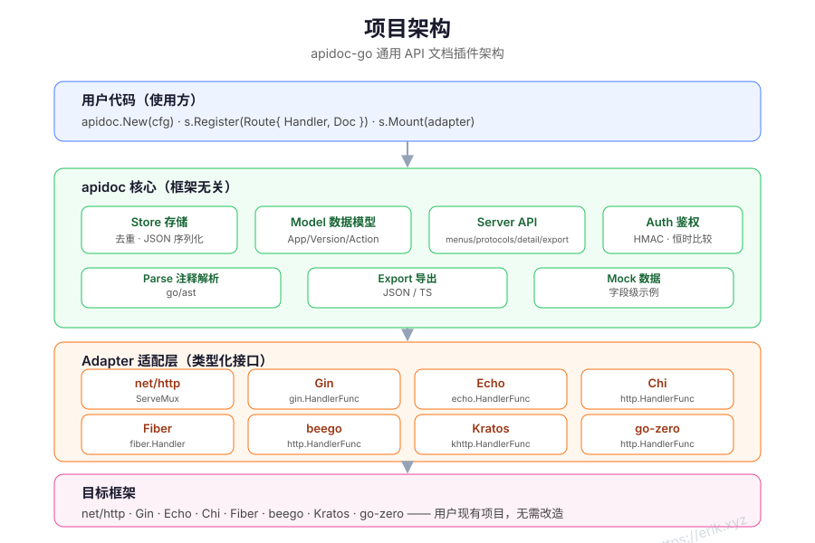
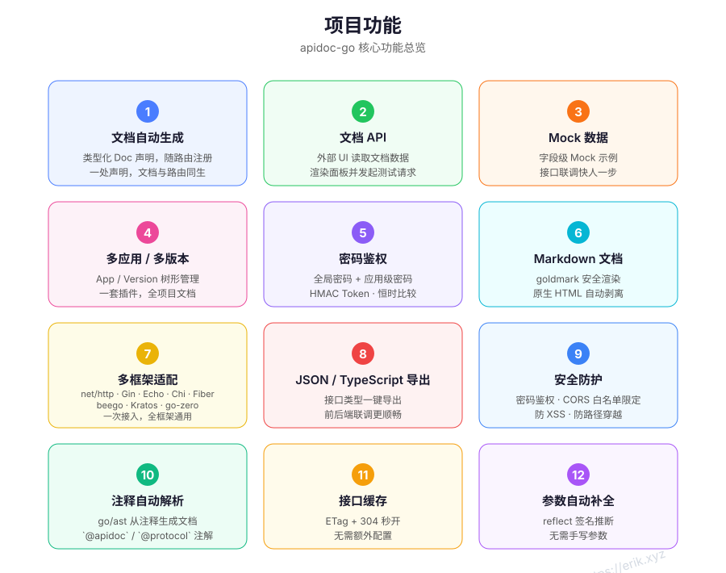
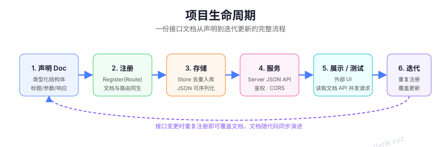

# apidoc-go — Go জেনেরিক API ডকুমেন্টেশন প্লাগইন

[中文](../../../README.md) · [English](../en/README.md) · [한국어](../ko/README.md) · [Русский](../ru/README.md) · [Deutsch](../de/README.md) · [Français](../fr/README.md) · [Español](../es/README.md) · [Português](../pt/README.md) · [हिन्दी](../hi/README.md) · [العربية](../ar/README.md) · [বাংলা](../bn/README.md) · [Bahasa Indonesia](../id/README.md) · [日本語](../ja/README.md)

## প্রকল্প পরিচিতি

**বর্তমান সংস্করণ: v1.1.1** ([Releases](https://github.com/erikwang2013/apidoc-go/releases) দেখুন)

**apidoc-go** একটি জেনেরিক Go API ডকুমেন্টেশন প্লাগইন লাইব্রেরি: ইন্টারফেস ডকুমেন্টেশন **টাইপযুক্ত স্ট্রাক্ট** হিসেবে রুট রেজিস্ট্রেশনের সাথে একসাথে ঘোষণা করা হয় — ডকুমেন্টেশন ও রুট একসাথে জন্ম নেয়। ডকুমেন্টেশন লিগ্যাসি `/api/*` এবং UIC-1 `/ui/v1/*` উভয় JSON API-এর মাধ্যমে পরিবেশিত হয়, তাই যেকোনো বাহ্যিক UI সেগুলো রেন্ডার করে পরীক্ষামূলক অনুরোধ পাঠাতে পারে — অথবা `Config.UIPath`-এর মাধ্যমে একই প্রসেসে প্যাকেজড Vue UI পরিবেশন করা যায়। এতে পাসওয়ার্ড অথেনটিকেশন, মাল্টি-অ্যাপ / মাল্টি-ভার্সন ম্যানেজমেন্ট, Mock ডেটা, JSON / TypeScript এক্সপোর্ট, কমেন্ট ও নয়-ফরম্যাট প্রোটোকল-ডেফিনিশন পার্সিং, রেসপন্স ক্যাশিং ও স্বয়ংক্রিয় প্যারামিটার কমপ্লিশন অন্তর্নির্মিত; সার্ভার-সাইড প্রোটোকল এক্সিকিউটর build tag অনুযায়ী চাহিদামতো কম্পাইল হয় এবং HTTP, RPC, socket, messaging, IoT, industrial ও media প্রোটোকল পরিবার কভার করে। একবার সংযুক্ত করলেই সব ফ্রেমওয়ার্কে কাজ করে — বিদ্যমান প্রজেক্টে কোনো পরিবর্তনের প্রয়োজন নেই।

## প্রকল্পের বৈশিষ্ট্য

| # | বৈশিষ্ট্য | বিবরণ |
|---|------|------|
| 1 | স্বয়ংক্রিয় ডকুমেন্টেশন জেনারেশন | টাইপযুক্ত Doc ঘোষণা, রুট রেজিস্ট্রেশনের সাথে; এক জায়গায় ঘোষণা, ডকুমেন্টেশন ও রুট একসাথে |
| 2 | ডকুমেন্টেশন API | লিগ্যাসি `/api/*` (menus / protocols / detail / export) এবং UIC-1 `/ui/v1/*` (docs, debug, shares, generators, export), বাহ্যিক UI বা বান্ডল করা Vue UI-এর জন্য |
| 3 | Mock ডেটা | ফিল্ড-স্তরের Mock উদাহরণ; ইন্টারফেস ইন্টিগ্রেশন দ্রুততর |
| 4 | মাল্টি-অ্যাপ / মাল্টি-ভার্সন | App / Version ট্রি-ভিত্তিক ম্যানেজমেন্ট; একটি প্লাগইনে পুরো প্রজেক্টের ডকুমেন্টেশন |
| 5 | পাসওয়ার্ড অথেনটিকেশন | গ্লোবাল পাসওয়ার্ড + অ্যাপ-স্তরের পাসওয়ার্ড; HMAC Token · কনস্ট্যান্ট-টাইম তুলনা |
| 6 | Markdown ডকুমেন্টেশন | goldmark নিরাপদ রেন্ডারিং; নেটিভ HTML স্বয়ংক্রিয়ভাবে অপসারিত |
| 7 | মাল্টি-ফ্রেমওয়ার্ক অ্যাডাপ্টেশন | net/http · Gin · Echo · Chi · Fiber · beego · Kratos · go-zero; একবার সংযুক্ত, সব ফ্রেমওয়ার্কে কার্যকর |
| 8 | JSON / TypeScript এক্সপোর্ট | ইন্টারফেস টাইপ এক ক্লিকে এক্সপোর্ট; ফ্রন্ট-ব্যাক ইন্টিগ্রেশন আরও সাবলীল |
| 9 | নিরাপত্তা সুরক্ষা | পাসওয়ার্ড অথেনটিকেশন · CORS হোয়াইটলিস্ট সীমাবদ্ধতা · XSS / পাথ ট্রাভার্সাল প্রতিরোধ · সার্ভার-সাইড ডিবাগের জন্য SSRF গার্ড এবং session/byte সীমা |
| 10 | অ্যানোটেশন ও ডেফিনিশন পার্সিং | go/ast `@apidoc` / `@protocol` / `@definition` পার্স করে; নয়টি অন্তর্নির্মিত ডেফিনিশন ফরম্যাট: OpenAPI, AsyncAPI, GraphQL, proto, WSDL, EDMX, JSON Schema, JSON-RPC এবং XML-RPC |
| 11 | HTTP ক্যাশিং | সংস্করণভিত্তিক রেসপন্স ক্যাশ + ETag/304, ডক এন্ডপয়েন্ট মিলিসেকেন্ডে সাড়া দেয় |
| 12 | স্বয়ংক্রিয় প্যারামিটার কমপ্লিশন | reflect হ্যান্ডলার সিগনেচার থেকে রিকোয়েস্ট প্যারামিটার অনুমান করে |
| 13 | যেকোনো প্রোটোকলের অ্যানোটেশন | `@protocol` প্রোটোকল চিহ্নিত করে; detail protocol/method/url/params/responses/mock-এর সাথে পার্স করা প্রোটোকল ডেফিনিশনও ফেরত দেয় |
| 14 | বান্ডল করা Vue UI (ঐচ্ছিক) | `Config.UIPath`-কে UIC-1 প্যাকেজড বিল্ডে নির্দেশ করুন যাতে একই প্রসেসে Vue UI পরিবেশিত হয়; খালি মান হলে JSON API-তে ফিরে যায় |
| 15 | সার্ভার-সাইড প্রোটোকল এক্সিকিউটর | build tag দিয়ে কম্পাইল হওয়া সাতটি প্রোটোকল পরিবার; ডিফল্টভাবে বন্ধ এবং কম্পাইল হয়নি এমন অবস্থায় fail closed, `apidoc_debug_all` সবকিছু সক্রিয় করে |

## আর্কিটেকচার ওভারভিউ







## প্রকল্প কাঠামো

```
apidoc-go/
├── apidoc.go            # মূল এন্ট্রি পয়েন্ট: New / Register / Mount / Handler
├── VERSION              # প্রজেক্ট সংস্করণ (v1.1.1); release workflow এটি থেকে ট্যাগ করে
├── doc.go               # Route / Doc / Param / Response টাইপ
├── model/               # ডেটা মডেল
│   ├── model.go         #   Project / App / Version / Controller / Action
│   ├── definition.go    #   @definition বাহ্যিক প্রোটোকল ডেফিনিশন
│   ├── protocol.go      #   URL স্কিম → প্রোটোকল
│   └── protocols.go     #   বিকল্প নাম / প্রোটোকল রেজিস্ট্রি / ডিফল্ট পোর্ট
├── store/               # স্টোরেজ ও ডি-ডুপ্লিকেশন
│   └── store.go         #   (app, version, method, url) ডি-ডুপ্লিকেশন, পরেরটি আগেরটিকে ওভাররাইট করে
├── auth/                # অথেনটিকেশন
│   └── auth.go          #   পাসওয়ার্ড যাচাই · HMAC Token ইস্যু ও যাচাই
├── server/              # HTTP API
│   ├── server.go        #   legacy /api রুট · auth / CORS / ক্যাশিং
│   ├── ui.go            #   UIPath স্ট্যাটিক Vue UI (SPA fallback · পাথ-সীমিত)
│   └── uiapi/           #   UIC-1 /ui/v1 API
│       ├── uiapi.go     #     capabilities / config / menus / detail
│       ├── read.go      #     ডকুমেন্ট রিড · ডেফিনিশন পার্সিং
│       ├── debug.go     #     debugSend / debugStart / debugPoll / debugStop
│       ├── manage.go    #     generators · code templates · shares · cache
│       ├── share.go
│       └── debug/       #     সার্ভার-সাইড প্রোটোকল এক্সিকিউটর (পরিবারপ্রতি build-tag)
├── adapter/             # ফ্রেমওয়ার্ক অ্যাডাপ্টেশন লেয়ার (টাইপযুক্ত ইন্টারফেস)
│   ├── adapter.go
│   ├── nethttp.go       #   net/http  ServeMux
│   ├── gin.go           #   gin.HandlerFunc
│   ├── echo.go          #   echo.HandlerFunc
│   ├── chi.go           #   http.HandlerFunc
│   └── fiber.go         #   fiber.Handler
├── parse/               # অ্যানোটেশন অটো-পার্সার
│   ├── parse.go         #   go/ast · @apidoc / @protocol / @definition
│   └── protocol/        #   নয়টি প্রোটোকল-ডেফিনিশন পার্সার
├── export/              # এক্সপোর্ট
│   └── export.go        #   TypeScript ইন্টারফেস ডেফিনিশন
├── mock/                # Mock ডেটা
│   └── mock.go          #   ফিল্ড-স্তরের উদাহরণ জেনারেশন
├── example/             # নমুনা প্রজেক্ট (৮টি ফ্রেমওয়ার্ক :8081–:8088)
│   ├── main.go
│   └── handlers/        #   @apidoc কমেন্ট উদাহরণ
└── docs/                # ডকুমেন্টেশন ও সম্পদ
    ├── alipay.png
    ├── weixinpay.png
    └── svg/             # আর্কিটেকচার ডায়াগ্রাম / ফিচার ডায়াগ্রাম / লাইফসাইকেল ডায়াগ্রাম
```

## ব্যবহার নির্দেশিকা

### ইনস্টলেশন

```bash
go get github.com/erikwang2013/apidoc-go
```

### দ্রুত শুরু (net/http)

```go
package main

import (
	"net/http"

	"github.com/erikwang2013/apidoc-go"
	"github.com/erikwang2013/apidoc-go/adapter"
)

func main() {
	mux := http.NewServeMux()
	s := apidoc.New(apidoc.Config{Title: "আমার API ডকুমেন্টেশন"})

	// ডকুমেন্টেশন এবং রুট একসাথে ঘোষণা করা হয়
	if err := s.Register(apidoc.Route{
		Method: "GET",
		URL:    "/hello",
		Handler: http.HandlerFunc(func(w http.ResponseWriter, r *http.Request) {
			w.Write([]byte("hello"))
		}),
		Doc: apidoc.Doc{
			App:     "demo",
			Version: "v1",
			Action:  "hello",
			Title:   "অভিবাদন",
			Params: []apidoc.Param{
				{Name: "name", Type: "string", Required: true, Desc: "আপনার নাম"},
			},
		},
	}); err != nil {
		panic(err)
	}

	s.Mount(adapter.NewNetHTTP(mux))
	http.ListenAndServe(":8080", mux)
	// বাহ্যিক UI /apidoc/api/menus বা UIC-1 /apidoc/ui/v1/* পড়ে;
	// UIPath সেট থাকলে সরাসরি http://localhost:8080/apidoc/ খুলুন
}
```

### UIC-1 বান্ডল করা Vue UI এবং সার্ভার-সাইড এক্সিকিউটর সক্রিয় করা

```go
s := apidoc.New(apidoc.Config{
	Prefix: "/apidoc",
	// ঐচ্ছিক: apidoc-ui-এর npm run package:ui-এর আউটপুট
	// (index.html / config.js / assets/)।
	// খালি রাখলে শুধু JSON API পরিবেশিত হবে এবং বাহ্যিক UI ব্যবহার চালু থাকবে।
	UIPath: "/srv/myapp/dist/uic1-ui",
	// সার্ভার-সাইড relay ডিফল্টভাবে বন্ধ; সক্রিয় করলেও এটি
	// SSRF হোয়াইটলিস্ট এবং byte/session সীমার অধীন থাকে।
	Debug: apidoc.DebugConfig{EnableServerSide: true},
})
```

এক্সিকিউটর build সময়ে প্রোটোকল পরিবার অনুযায়ী নির্বাচিত হয়: `go build -tags apidoc_debug_all` সবগুলো কম্পাইল করে, অথবা `apidoc_debug_http`, `apidoc_debug_sockets`, `apidoc_debug_rpc`, `apidoc_debug_grpc`, `apidoc_debug_http3`, `apidoc_debug_messaging`, `apidoc_debug_iot`, `apidoc_debug_industrial` এবং `apidoc_debug_media` দিয়ে সেগুলো ছাঁটুন। যেসব প্রোটোকল কম্পাইল করা হয়নি সেগুলোর কলে সর্বদা fail closed হয়।

### যেকোনো প্রোটোকলের অ্যানোটেশন

অ-HTTP ইন্টারফেসগুলো `@method` + `@url` পুনরায় ব্যবহার করে এবং `@protocol` দিয়ে প্রোটোকল নির্দিষ্ট করে (URL scheme থেকেও অনুমান করা যায়):

```go
// @apidoc
// @protocol mqtt
// @method PUBLISH
// @url mqtt://broker:1883/sensors/temp
// @title তাপমাত্রা প্রকাশ
// @param qos int false "QoS" in=option default=1
// @param payload json true "বার্তার বডি" in=payload
func PublishTemp() {}
```

`@protocol` সম্পূর্ণ প্রোটোকল তালিকা ও তাদের
উপনাম গ্রহণ করে (HTTP/2, HTTP/3, SOAP, GraphQL, JSON-RPC, XML-RPC, OData, Webhooks, gRPC, Dubbo, Thrift, Hessian, MCP, A2A, ISO 8583, WebSocket, SSE, Socket.IO, WebRTC DataChannel, RTSP, RTMP, HLS, SIP, XMPP, AMQP, MQTT, STOMP, Kafka, CoAP, LwM2M, OPC UA, Modbus TCP, DNP3, IEC 60870-5-104, BACnet/IP, RTP, RTCP, TCP, UDP, Raw Socket, Unix Domain Socket); সম্পূর্ণ key, উপনাম, scheme ও ডিফল্ট পোর্ট রেজিস্ট্রি `GET /api/protocols`-এ রয়েছে।
বাইনারি body `@param ... type=binary` (বা `hex`/`base64`) + `in=payload` দিয়ে ঘোষণা করুন।

`/api/detail` এবং UIC-1 `/ui/v1/docDetail` `protocol`, `protocol_info`, `method`, `url`, `params`, `responses`, `mock` এবং পার্স করা `definitions` ফেরত দেয়।

ডিবাগিংয়ের দুটি চ্যানেল আছে: সরাসরি ব্রাউজার থেকে (HTTP / WebSocket / SSE, সর্বদা উপলব্ধ) এবং সার্ভার-সাইড relay (`Debug` সক্রিয় থাকলে এবং সংশ্লিষ্ট build tag থাকলে)। সার্ভার-সাইড প্রোটোকল পরিবারগুলো হলো HTTP (http / http2 / http3 / SOAP / GraphQL / JSON-RPC / XML-RPC / OData / MCP / A2A / Webhook), RPC (gRPC / Thrift / Dubbo / Hessian / ISO 8583), sockets (TCP / UDP / Raw / Unix), messaging (MQTT / STOMP / AMQP / Kafka / XMPP), IoT (CoAP / LwM2M), industrial (Modbus / DNP3 / IEC 104 / BACnet / OPC UA) এবং media (RTSP / SIP / RTP / RTCP / RTMP)।
ডিফল্ট বিল্ড কোনো এক্সিকিউটর কম্পাইল করে না; সক্রিয় করলে টার্গেটগুলোকে প্রথমে SSRF গার্ড পাস করতে হয় (`AllowHosts` হোয়াইটলিস্ট, private/loopback/link-local/cloud-metadata ঠিকানা ডিফল্টভাবে নিষিদ্ধ, DNS resolution-এর পরে প্রতি-IP যাচাই এবং connection pinned), এবং সেগুলো timeouts, প্রতি-বার্তায় 1 MiB সীমা, রেসপন্স `MaxBytes` ও stream-session সীমার মধ্যে সীমিত থাকে।

### প্রোটোকল ডেফিনিশন পার্সিং (@definition)

বাহ্যিক প্রোটোকল ডেফিনিশন অন্তর্ভুক্ত করতে `@definition` ব্যবহার করুন
(ফরম্যাট স্বয়ংক্রিয়ভাবে শনাক্ত হয়, অথবা `format=` দিয়ে নির্ধারণ করুন); পার্স করা ফলাফল detail-এর সাথে ফেরত দেওয়া হয় যাতে UIC বার্তা কাঠামো রেন্ডার করতে ও ডিবাগ ফর্ম তৈরি করতে পারে:

```go
// @apidoc
// @protocol http
// @method POST
// @url /api/v1/users
// @definition file=specs/openapi.yaml operation=createUser
// @definition file=specs/service.proto message=User
```

সমর্থিত ফরম্যাট: OpenAPI, AsyncAPI, GraphQL SDL, proto, WSDL, EDMX (OData), JSON Schema, JSON-RPC এবং XML-RPC। `Config.DefinitionRoot` পঠনযোগ্য ফাইলগুলোকে একটি রুট ডিরেক্টরিতে সীমাবদ্ধ করে (ডিফল্ট: প্রসেসের কার্যশীল ডিরেক্টরি); পার্সিং প্রতি ফাইলে 1 MiB ও 50,000 লাইন এবং 32-এর নেস্টেড-রেফারেন্স গভীরতায় সীমিত; `operation=`, `message=`, `direction=`, `sample=` ও `inline=`-এর মতো অপশনের জন্য `parse` প্যাকেজের কমেন্ট দেখুন।

### দ্রুত শুরু (Gin)

```go
r := gin.Default()
s := apidoc.New(apidoc.Config{Title: "আমার API ডকুমেন্টেশন"})

s.Register(apidoc.Route{
	Method:  "GET",
	URL:     "/hello",
	Handler: func(c *gin.Context) { c.String(200, "hello") },
	Doc:     apidoc.Doc{App: "demo", Version: "v1", Action: "hello", Title: "অভিবাদন"},
})

s.Mount(adapter.NewGin(r))
r.Run(":8080")
```

Echo / Chi / Fiber-এর ক্ষেত্রে শুধু অ্যাডাপ্টার কনস্ট্রাক্টর পরিবর্তন করুন: `adapter.NewEcho(e)`, `adapter.NewChi(mux)`, `adapter.NewFiber(app)` — বাকি কোড সম্পূর্ণ একই থাকে। beego / Kratos / go-zero-এর জন্য নিচের ফ্রেমওয়ার্ক অ্যাডাপ্টার টেবিল দেখুন।

### কনফিগ অপশন

| অপশন | ডিফল্ট | বিবরণ |
|--------|--------|------|
| `Prefix` | `/apidoc` | ডকুমেন্টেশন মাউন্ট পাথ |
| `Title` | `API Docs` | ডকুমেন্টেশন শিরোনাম |
| `Desc` | — | ডকুমেন্টেশন বিবরণ |
| `GlobalParams` | — | গ্লোবাল প্যারামিটার, প্রতিটি Action-এ মিশে যায় |
| `Auth` | — | অথেনটিকেশন কনফিগ: `Enable` / `Password` / `Secret` / `Expire` / `Secure` |
| `Apps` | — | অ্যাপ কনফিগ: `Key` / `Title` / `Password` (অ্যাপ-স্তরের স্বাধীন পাসওয়ার্ড) |
| `DebugOrigins` | — | ডকুমেন্টেশন API ক্রস-অরিজিনে পড়ার অনুমতিপ্রাপ্ত উৎস (বাহ্যিক UI, ডিফল্ট: কিছুই নেই) |
| `PublicHost` | — | বাহ্যিক UI ডিবাগিংয়ের জন্য ব্যবহৃত পরম বেস URL; খালি মানে same-origin |
| `ShareDir` | টেম্প ডিরেক্টরির অধীনে `apidoc-go-shares` | UIC-1 শেয়ার-রেকর্ড ডিরেক্টরি |
| `DefinitionRoot` | প্রসেসের কার্যশীল ডিরেক্টরি | `@definition` ফাইল রুট; রুটের বাইরের পাথ ও symlink প্রত্যাখ্যাত |
| `Generator` / `CodeTemplates` | — | ডিক্লারেটিভ generators ও code templates (রেন্ডারিং side-effect free) |
| `ShareActions` | — | UI দ্বারা ব্যাখ্যাত share-action ঘোষণা |
| `Debug` | শূন্য মান = বন্ধ | সার্ভার-সাইড এক্সিকিউটর: `EnableServerSide` / `AllowPrivateNetworks` / `AllowHosts` / `AllowUnixSockets` / `TimeoutMS` / `MaxBytes` |
| `UIPath` | — (কোনো বান্ডল UI নেই) | প্যাকেজড UIC-1 Vue বিল্ডের ডিরেক্টরি; খালি না হলে `{Prefix}/`-এর অধীনে একই প্রসেসে স্ট্যাটিক UI পরিবেশন করে |

### UIC-1 API এবং বান্ডল করা Vue UI (ঐচ্ছিক)

লাইব্রেরি ডিফল্টভাবে দুটি JSON ডকুমেন্টেশন API পরিবেশন করে: লিগ্যাসি `/api/*` এবং UIC-1 `/ui/v1/*`, যা বাহ্যিক UI ব্যবহার করে। `GET {Prefix}/ui/v1/capabilities` কনট্র্যাক্ট, ব্যাকএন্ড সংস্করণ ও ফিচার ম্যাট্রিক্স (browser/server ডিবাগ মোড, shares, cache, generators, export, auth) ফেরত দেয়; UI এটি দিয়ে নির্ধারণ করে কোন প্যানেলগুলো উপলব্ধ। `/ui/v1/config` menus-এর সাথে generator ও code-template কনফিগারেশন ফেরত দেয়। প্যাকেজড `apidoc-ui` বিল্ড `Config.UIPath`-এ দেওয়ার পর, একই প্রসেস Vue UI সরাসরি `{Prefix}/`-এর অধীনেও পরিবেশন করে:

```go
s := apidoc.New(apidoc.Config{
	Prefix: "/apidoc",
	UIPath: "/srv/myapp/dist/uic1-ui", // scripts/package-ui.sh-এর আউটপুট ডিরেক্টরি
})
```

লাইব্রেরি নিজে ফ্রন্টএন্ড অ্যাসেট embed করে না, তাই build-time নির্ভরতা নেই; bundled-UI রিলিজ প্যাকেজের উচিত ডিফল্টভাবে `UIPath`-কে শিপ করা `dist/uic1-ui/` ডিরেক্টরিতে নির্দেশ করা — উপরের wiring-ই প্রস্তাবিত সেটআপ। ডিপ্লয়মেন্ট ধাপ:

1. UI রিপোজিটরিতে বিল্ড ও প্যাকেজ করুন: `npm run package:ui` (আউটপুট `dist/uic1-ui/`)।
2. টার্গেট ডিরেক্টরিতে ডিপ্লয় করুন (এটি থাকতে হবে এবং খালি হতে হবে, অথবা পূর্ববর্তী uic1-ui প্যাকেজ ধারণ করবে): `npm run package:ui -- --dest /srv/myapp/dist/uic1-ui`।
3. স্টার্টআপে `UIPath` সেট করুন; শুধু-ডকুমেন্টেশন-API মোডে ফিরতে এটি খালি রেখে পুনরায় চালু করুন।

আচরণ:

- `{Prefix}/`, `{Prefix}/index.html`, `{Prefix}/config.js` এবং `{Prefix}/assets/*` স্ট্যাটিক ফাইল হিসেবে পরিবেশিত হয়, MIME টাইপ এক্সটেনশন দ্বারা নির্ধারিত;
- অজানা এক্সটেনশনহীন পাথ `index.html`-এ ফিরে যায় (SPA fallback); অনুপস্থিত `.js` / `.css` ও অনুরূপ অ্যাসেট 404 ফেরত দেয়;
- `{Prefix}` (ট্রেইলিং স্ল্যাশ ছাড়া) 307 দিয়ে `{Prefix}/`-এ রিডাইরেক্ট করে যাতে আপেক্ষিক অ্যাসেট পাথ সঠিক থাকে;
- `{Prefix}/api/*` ও `{Prefix}/ui/v1/*` অগ্রাধিকার পায়; অজানা API পাথ 404 ফেরত দেয় এবং কখনো UI-তে ফিরে যায় না;
- ফাইল অ্যাক্সেস `UIPath`-এ সীমাবদ্ধ (`..` ও রুটের বাইরের symlink প্রত্যাখ্যাত), কোনো ডিরেক্টরি লিস্টিং নেই; ডিরেক্টরি বা `index.html` অনুপস্থিত থাকলে UI রুট 500 ফেরত দেয় এবং ডকুমেন্টেশন API অপ্রভাবিত থাকে;
- go-zero অ্যাডাপ্টার কেবল নির্দিষ্ট API রুট রেজিস্টার করে এবং prefix-এর অধীনে ইচ্ছামতো পাথ ফরওয়ার্ড করে না, তাই ওই অ্যাডাপ্টারে বান্ডল UI অনুপলব্ধ (অন্য সব অ্যাডাপ্টার এটি সমর্থন করে);
- যেসব ডিপ্লয়মেন্ট এখনো বাহ্যিক UI ব্যবহার করে তাদের কোনো পরিবর্তন লাগবে না; শুধু `config.js`-এ `HTTP.API_PREFIX`-কে সার্ভারের `Prefix`-এর সমান রাখুন।

### সার্ভার-সাইড প্রোটোকল এক্সিকিউটর (বিল্ড ট্যাগ)

সার্ভার-সাইড relay ডিফল্টভাবে কোনো এক্সিকিউটর কম্পাইল করে না, এবং কম্পাইল না করা প্রোটোকল কল করলে fail-closed ত্রুটি ফেরত আসে। প্রোটোকল পরিবার অনুযায়ী build tag নির্বাচন করুন; `apidoc_debug_all` সেগুলোকে একত্র করে:

| বিল্ড ট্যাগ | প্রোটোকল পরিবার | প্রোটোকল |
|-----------|-----------------|-----------|
| `apidoc_debug_http` | HTTP / Web | http, http2, soap, graphql, jsonrpc, xmlrpc, odata, mcp, a2a, webhook |
| `apidoc_debug_http3` | HTTP/3 | http3 (QUIC, কেবল https) |
| `apidoc_debug_sockets` | সকেট | tcp, udp, raw, unix (unary + streaming) |
| `apidoc_debug_rpc` | RPC / ফিন্যান্স | thrift, dubbo, hessian, iso8583 |
| `apidoc_debug_grpc` | gRPC | grpc (unary; descriptor বা server reflection) |
| `apidoc_debug_messaging` | মেসেজিং | mqtt, stomp, amqp, kafka, xmpp (unary + streaming; `apidoc_debug_mqtt` / `_stomp` / `_amqp` / `_kafka` / `_xmpp` দিয়ে আলাদাভাবেও নির্বাচনযোগ্য) |
| `apidoc_debug_iot` | IoT | coap, lwm2m |
| `apidoc_debug_industrial` | শিল্প | modbus, dnp3, iec104, bacnet, opcua |
| `apidoc_debug_media` | মিডিয়া | rtsp, sip, rtp, rtcp, rtmp |
| `apidoc_debug_all` | সব | উপরের প্রতিটি পরিবার |

নিরাপত্তা সীমা: `Debug.EnableServerSide` ডিফল্টভাবে বন্ধ; সক্রিয় করলেও টার্গেটগুলোকে `AllowHosts` হোয়াইটলিস্ট পাস করতে হয় (suffix মিল যেমন `*.example.com`), private/loopback/link-local/CGNAT ও cloud-metadata ঠিকানা ডিফল্টভাবে নিষিদ্ধ (কেবল `AllowPrivateNetworks` সেগুলো অনুমোদন করে), DNS resolution-এর পরে প্রতি-IP যাচাই হয় এবং connection pinned থাকে, এবং `CONNECT`, redirects ও proxies নিষিদ্ধ; অনুরোধ ও প্রতিক্রিয়া `TimeoutMS`, `MaxBytes` (ডিফল্ট 1 MiB), stream sessions (স্কোপপ্রতি 4), frame counts ও idle timeouts দ্বারা সীমিত। ডেফিনিশন পার্সিং কেবল `DefinitionRoot`-এর ভিতরের নিয়মিত ফাইল পড়ে, যা ফাইল আকার, লাইন সংখ্যা ও reference গভীরতা দ্বারা সীমিত।

### ফ্রেমওয়ার্ক অ্যাডাপ্টার

| ফ্রেমওয়ার্ক | কনস্ট্রাক্টর |
|------|--------|
| net/http | `adapter.NewNetHTTP(mux)` |
| Gin | `adapter.NewGin(engine)` |
| Echo | `adapter.NewEcho(e)` |
| Chi | `adapter.NewChi(mux)` |
| Fiber | `adapter.NewFiber(app)` |
| beego | `adapter.NewBeego(app)` |
| Kratos | `adapter.NewKratos(srv)` |
| go-zero | `adapter.NewGoZero(srv)` |

### অ্যানোটেশন স্বয়ংক্রিয় পার্সিং (go/ast)
হ্যান্ডলারের উপরে `@apidoc` কমেন্ট লিখুন, তারপর পার্স ফলাফল রেজিস্টার করুন:

```go
// @apidoc
// @method POST
// @url /api/v1/users
// @title Create user
// @param name string true "Username"
// @success ok User "Success"
func CreateUser(c *gin.Context, req *CreateUserReq) { ... }
```

```go
results, err := parse.ParseDir("./handlers")
if err != nil { log.Fatal(err) }
for _, r := range results {
    s.Register(apidoc.Route{Method: r.Method, URL: r.URL, Handler: CreateUser, Doc: r.Doc})
}
```

### স্বয়ংক্রিয় প্যারামিটার কমপ্লিশন (reflect)
যখন `Doc.Params` খালি থাকে, Register হ্যান্ডলার সিগনেচার থেকে reflect-এর মাধ্যমে প্যারামিটার অনুমান করে: স্ট্রাক্ট আর্গুমেন্ট body ফিল্ডে বিস্তৃত হয় (json ট্যাগ অনুযায়ী), আর ফ্রেমওয়ার্ক কনটেক্সট (gin.Context / echo.Context / fiber.Ctx) স্বয়ংক্রিয়ভাবে বাদ যায়।

### HTTP ক্যাশিং (রেসপন্স ক্যাশ + ETag)
`/api/menus`, `/api/protocols`, `/api/export`-এর রেসপন্স ডক সংস্করণ অনুযায়ী একবার সিরিয়ালাইজ করে প্রসেস মেমোরিতে ক্যাশ করা হয়; `Handler` তৈরির সময় প্রিহিট হয় এবং `Register` / `SetAppMeta`-এর পরে স্বয়ংক্রিয়ভাবে বাতিল হয়। রেসপন্সে `ETag` + `Cache-Control: private, max-age=300` থাকে, তাই বারবার ভিজিটে 304 পাওয়া যায়। কোনো কনফিগারেশনের প্রয়োজন নেই।

### এক্সপোর্ট
| ফরম্যাট | এন্ডপয়েন্ট | বিবরণ |
|--------|----------|------|
| JSON | `GET /apidoc/api/export` | সম্পূর্ণ প্রজেক্ট ট্রি |
| TypeScript | `GET /apidoc/api/export?format=typescript` | ইন্টারফেস টাইপ ডেফিনিশন |

### Mock ডেটা
ডিটেইল পেজ স্বয়ংক্রিয়ভাবে একটি Mock উদাহরণ দেখায়: `Doc.Params[].Mock` দিয়ে কাস্টমাইজ করুন, অথবা ফিল্ড টাইপ থেকে জেনারেট হতে দিন (string→"sample", int→0, bool→true, ...)।

### নমুনা প্রজেক্ট
`example/`-এ ৮টি ফ্রেমওয়ার্ক সার্ভার রয়েছে (net/http :8081, Gin :8082, Echo :8083, Chi :8084, Fiber :8085, beego :8086, Kratos :8087, go-zero :8088)। `go run ./example` দিয়ে সবগুলো চালু করুন; লিগ্যাসি ডক API প্রতিটি পোর্টের `/apidoc/api/...`-এ, UIC-1 API `/apidoc/ui/v1/...`-এ থাকে, এবং বাহ্যিক UI বা `UIPath`-এর মাধ্যমে বান্ডল করা Vue UI সেগুলো ব্যবহার করতে পারে।

## বহুভাষিক ডকুমেন্টেশন

| ভাষা | লিংক |
|------|------|
| English | [English](../en/README.md) |
| 한국어 | [한국어](../ko/README.md) |
| Русский | [Русский](../ru/README.md) |
| Deutsch | [Deutsch](../de/README.md) |
| Français | [Français](../fr/README.md) |
| Español | [Español](../es/README.md) |
| Português | [Português](../pt/README.md) |
| हिन्दी | [हिन्दी](../hi/README.md) |
| العربية | [العربية](../ar/README.md) |
| বাংলা | [বাংলা](../bn/README.md) |
| Bahasa Indonesia | [Bahasa Indonesia](../id/README.md) |
| 日本語 | [日本語](../ja/README.md) |

## আমাদের সমর্থন করুন

প্রকল্পটি আপনার কাজে লাগলে অনুগ্রহ করে স্ক্যান করে ডোনেশন করুন — এতে আমাদের এটি বজায় রাখার এবং নিয়মিত আপডেট করার উৎসাহ জাগবে!

<div align="center">
  
  
  <p>WeChat Pay (বামে) · Alipay (ডানে)</p>
</div>

### গ্লোবাল ট্রান্সফার ডোনেশন

**【প্রাপকের তথ্য】**
প্রাপকের নাম: WANG KEXUN
প্রাপকের অ্যাকাউন্ট নম্বর: 881015918251

**【প্রাপক ব্যাংক】**
ZA Bank
SWIFT কোড: AABLHKHHXXX
ব্যাংকের নাম: ZA Bank Limited
ব্যাংক কোড: 387
ব্যাংকের ঠিকানা: Core F, Cyberport 3, 100 Cyberport Road, Hong Kong

**【ক্রস-বর্ডার রেমিট্যান্স করেসপন্ডেন্ট ব্যাংক (যদি প্রয়োজন হয়)】**

অনুগ্রহ করে লক্ষ্য করুন: এটি ক্রস-বর্ডার রেমিট্যান্স করেসপন্ডেন্ট (মধ্যস্থতাকারী) ব্যাংকের তথ্য, প্রাপক ব্যাংকের তথ্য নয়। আপনার রেমিটিং ব্যাংককে জিজ্ঞাসা করুন এই তথ্য প্রদান করা প্রয়োজন কিনা।

হংকং ডলার, রেনমিনবি এবং মার্কিন ডলার জমার জন্য করেসপন্ডেন্ট ব্যাংক হলো Citibank ——

ব্যাংকের নাম: Citibank N.A. Hong Kong
SWIFT কোড: CITIHKHXXXX
ব্যাংক কোড: 006
শাখার নাম: Hong Kong Branch
শাখা কোড: 391
ব্যাংকের ঠিকানা: Citibank Tower, Citibank Plaza, 3 Garden Road, Central, Hong Kong

অন্যান্য মুদ্রার জন্য করেসপন্ডেন্ট ব্যাংক হলো BNY Mellon ——

ব্যাংকের নাম: THE BANK OF NEW YORK MELLON
SWIFT কোড: IRVTUS3NXXX
ব্যাংকের ঠিকানা: THE BANK OF NEW YORK MELLON, 240 GREENWICH STREET, NEW YORK, United States

---

<div align="center">Made with ❤️ by <a href="https://erik.xyz">erik.xyz</a></div>
